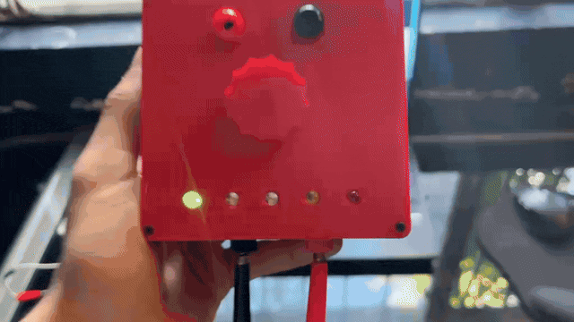
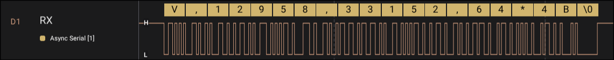
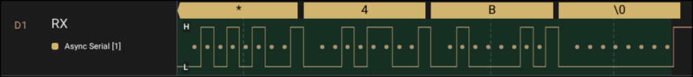
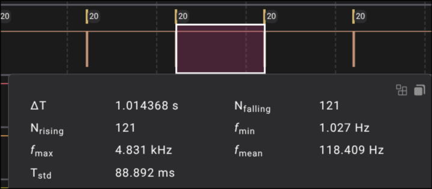
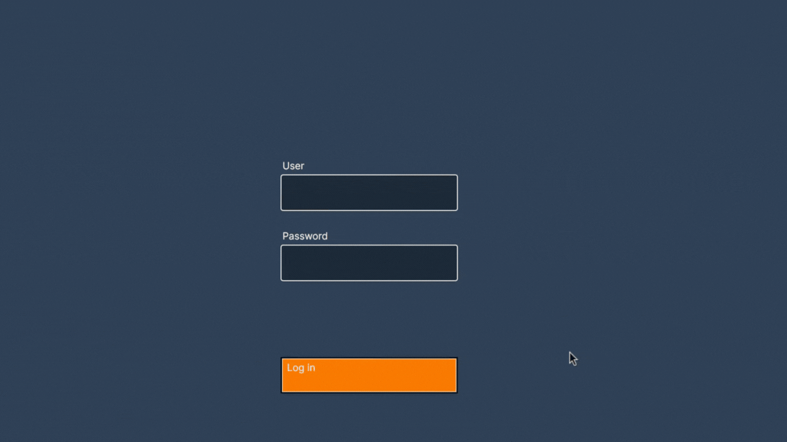

# VoltageSystem: Bare-Metal Voltage Acquisition over UART (CH32V003)

A **CH32V003 (RISC-V)** measures a voltage and streams it to a PC over UART in a **checksum-protected ASCII frame**. The PC app validates each frame and logs it to SQLite.

**100% bare metal:** no HAL, no RTOS. The GPIO, USART, ADC and TIM drivers were written from scratch at register level from the reference manual.

- Drivers library: [ch32v003-peripheral-drivers](https://github.com/AlexBh1304/ch32v003-peripheral-drivers)
- PC application: [VoltageSystem](https://github.com/AlexBh1304/VoltageSystem-PC)



---

## What this project shows

| Area | Implementation |
|------|----------------|
| **UART** | Custom USART driver, 9600 8N1, byte-wise TX |
| **GPIO** | Custom GPIO driver |
| **ADC** | Custom driver, 241-cycle sample time, 64x oversampling |
| **Timer** | TIM2 update flag as a fixed time base |
| **Protocol** | Hand-built ASCII frame with sequence number and checksum |
| **Constraints** | No floating point, no heap; 16 KB flash / 2 KB RAM |

---

## UART Frame

```
V,<SEQ>,<SUM>,<N>*<CS>\0
```

Example (the frame captured below): `V,12958,33152,64*4B`

| Field | Meaning |
|-------|---------|
| `V` | Frame type (voltage) |
| `SEQ` | 16-bit counter, +1 per frame, wraps at 65535 |
| `SUM` | Sum of N ADC samples |
| `N` | Sample count (64) |
| `CS` | 8-bit checksum, two uppercase hex digits |
| `\0` | Transmitted as an explicit end-of-frame byte |



### Error detection

1. **Checksum:** 8-bit sum (mod 256) of every byte from `V` to the last digit of `N` (excluding `*`). The PC recomputes it and rejects corrupted frames, showing the error in the UI.
2. **Sequence number:** `SEQ` increments every frame, so a gap reveals **lost frames** even when each received frame is valid. The PC app tracks it (with 16-bit wraparound) and shows a live lost-frames counter.

```c
uint8_t CheckSum(char* pStart, char* pEnd)
{
    uint8_t sum = 0;
    while(pStart <= pEnd)
    {
        sum+= *pStart;
        pStart++;
    }

    return sum;
}
```

For the captured frame `V,12958,33152,64`, the byte values add up to 843, and 843 mod 256 = 75 = 0x4B, which is the `*4B` seen on the wire.



### How the frame is built

`CreateFrame()` writes into a stack buffer through a moving pointer: header, `SEQ` and `SUM` converted with a custom `NumberToString()`, then `N`, then the checksum split into nibbles and converted with `NibbleToHex()`.

---

## Measurement and timing

- Each frame carries the **sum of 64 ADC readings**. The PC divides by `N` to get the mean and scales it to volts, so the MCU never uses floating point.
- 64 x 1023 = 65,472 fits exactly in a `uint16_t` (10-bit ADC), so the accumulator cannot overflow.
- TIM2 (`PSC=7999`, `ATRLR=999`) gives a fixed frame period by polling its update flag. At an 8 MHz timer clock that is 1 frame per second.



---

## PC side



The app (C# / Avalonia) reads frames from the serial port, validates the checksum, converts the sum to volts, shows the live value and a lost-frame counter, records runs of 50 measurements into SQLite and exports them to CSV.

---

## Build and flash

- **Toolchain:** `riscv-none-elf-gcc`
- **Programmer/debugger:** WCH-Link
- **Target:** CH32V003, no vendor HAL or SDK, only the custom drivers from the [drivers library](https://github.com/AlexBh1304/ch32v003-peripheral-drivers)

## Next steps

Flag or discard runs that contain lost frames, CRC-16 instead of the additive checksum, interrupt/DMA-driven TX, configurable sample rate from the PC.
